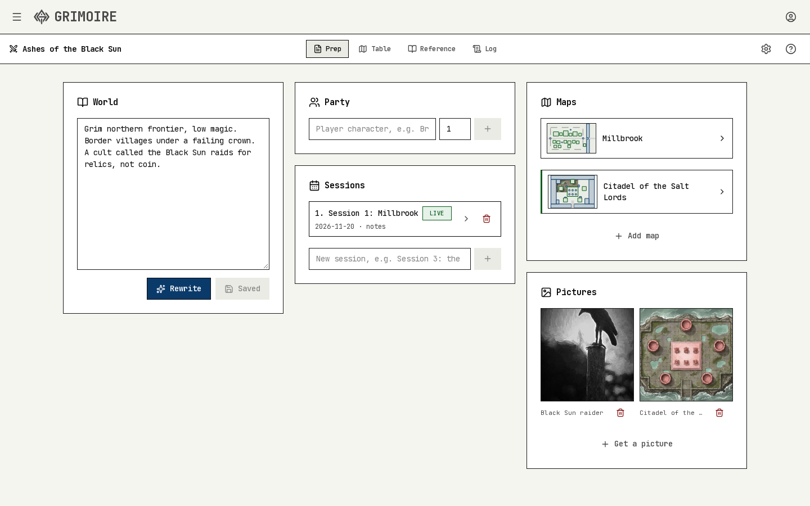
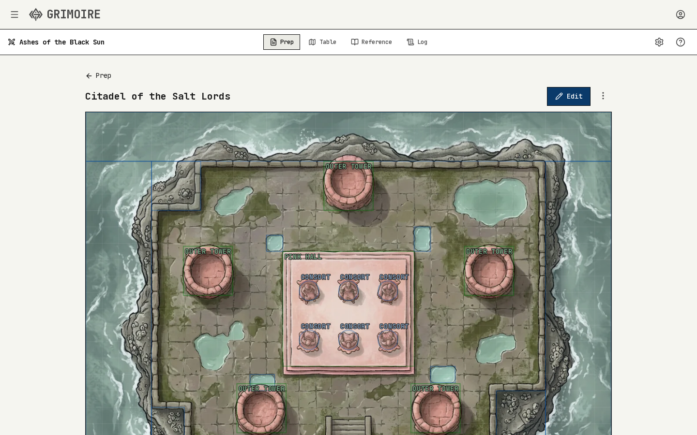
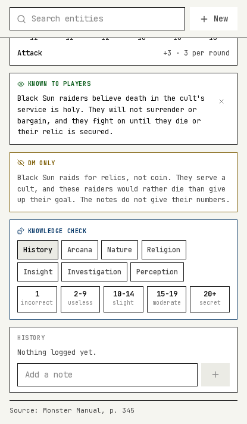
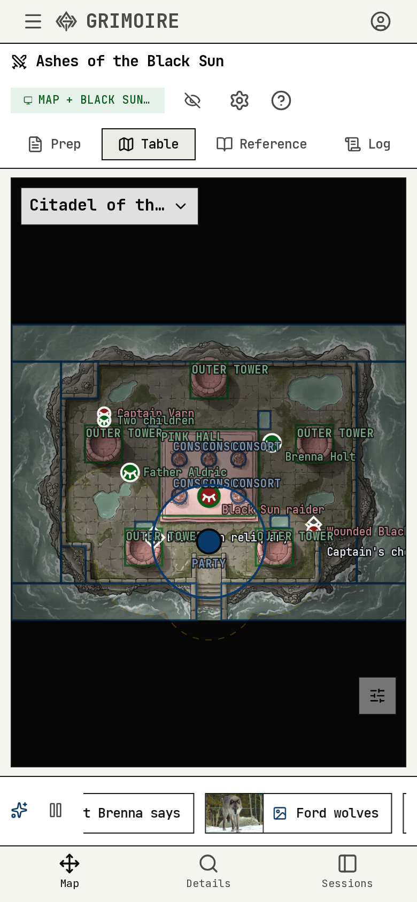

# Oracle

Oracle is a toolkit for a Dungeons & Dragons (5th edition, 2014 rules) Dungeon Master (DM). The DM runs the night from a map with fog of war, a details panel and a banner of ideas, while a shared screen shows the players the map and only what the DM has revealed.

## Key Features

- **Campaigns and Sessions**: A campaign holds world notes, a party, maps, pictures and one session per night; the live session is the one the Table runs.
- **Generated Prep**: Generate writes the world notes, and **Build entities** turns rough session notes into the creatures, people, places and items they need.
- **Map and Fog**: The party token sees a circle around it. Ground the party has seen stays dim and never shows creatures, and ground they have not seen is black.
- **Details Panel**: Search for an entity, or tap it on the map, to see its stats, what players know, DM only notes and its history.
- **Knowledge Checks**: The DM picks the skill and taps the result the players rolled, and Oracle writes a fact of that quality to reveal.
- **Ideas Banner**: Lines a character might say, complications, rewards and reference pictures scroll along the bottom of the Table; tap one to use it.
- **Player Display**: A shared screen shows the map on the left and the revealed entity on the right, and never anything still hidden.
- **Phone View**: On a phone, the Table splits into Map, Details and Sessions tabs.

## Configuration

Oracle's settings are per user, under the gear on the Oracle home page:

- **Seconds per new idea**: how fast new ideas reach the banner.
- **Mix in reference pictures**: adds pictures to the banner.
- **Allow homebrew creatures**: lets generated ideas invent creatures instead of using only the campaign's own.
- **Models**: the Claude model used for each kind of generated text.

Pictures can be generated, instead of found on the web, once an OpenRouter key is set in GRIMOIRE's **Models** settings.

## How to Use

### Preparing a Campaign

1. Open Oracle, enter a campaign name and select **New campaign**.
1. On the **Prep** tab, write a few sentences on the world, or select **Generate**, then add the party and a session:

   

1. Open the session, paste rough notes for the night and select **Build entities**, then **Add to campaign**:

   

1. Select **Add map** on the Prep tab to draw a map from a description or start a blank one, then open it to set its picture and scale:

   

### Running the Table

1. Select **Go live** on the session being played, then open the **Table** tab.
1. Drag the party token to move it; right-click the ground to reveal or hide a circle, paint fog, or add an entry.
1. Tap an entity on the map, or search for it, to open its details; select **Show details to players** to put it on the player display.
1. When the players roll to know something, pick the skill, then tap the result they reached, and select **Reveal**:

   

1. Tap an idea in the banner for three ready answers, or **Pin** it to keep it at the front; tap a picture to add it to the session, then tap the map where it goes.

### Showing the Players

1. Select **Open Player Screen** on the Oracle home page, or open the display link from the Table, on the shared screen.
1. Sign in on that screen; the players see the map and the revealed entity:

   

### Running From a Phone

1. Open the campaign's Table on a phone and switch between **Map**, **Details** and **Sessions** at the bottom:

   
