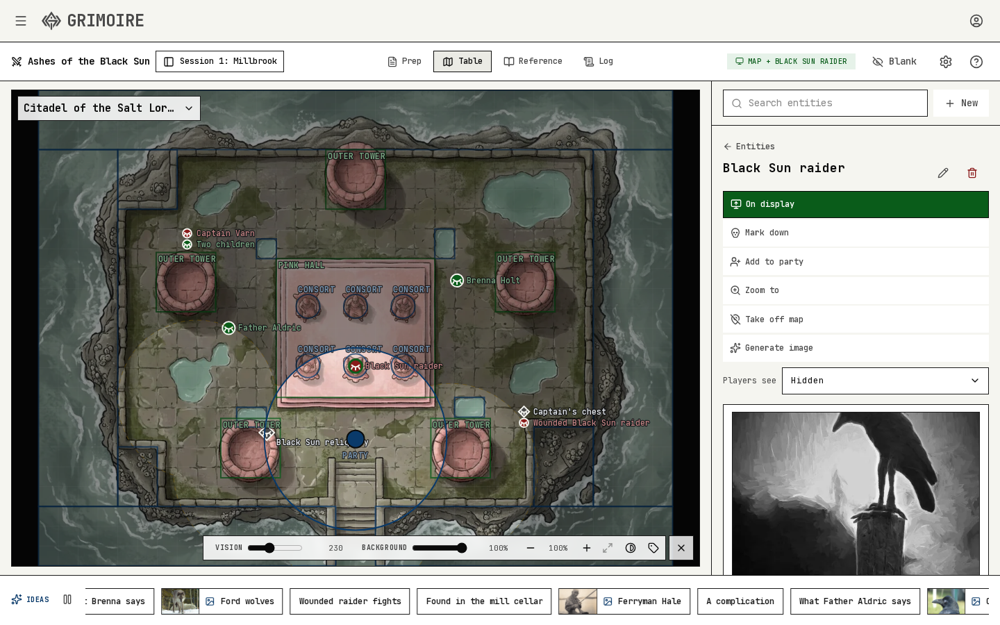
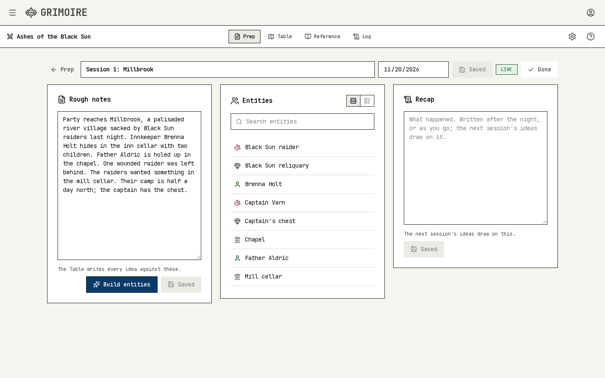
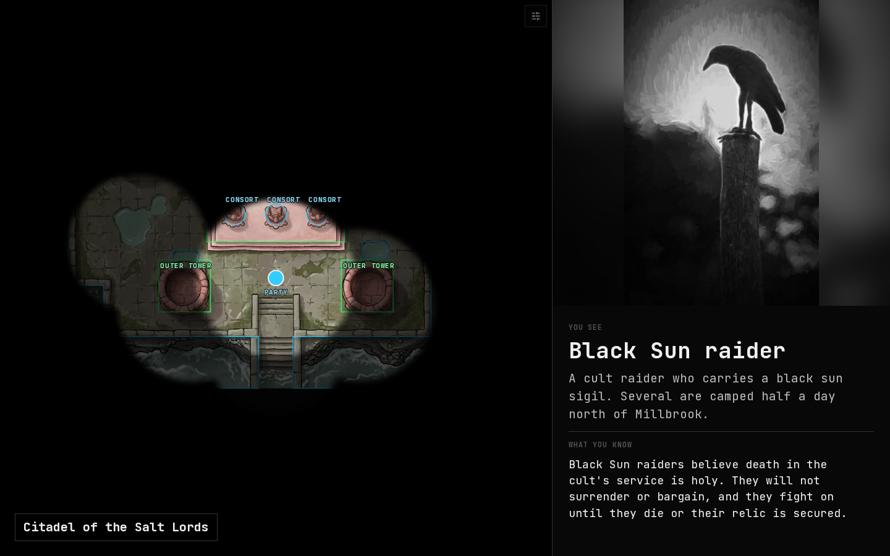

# Oracle

Oracle is a Dungeon Master (DM) virtual tabletop for in-person Dungeons & Dragons (5th edition, 2014 rules). It splits the game in two: the DM runs the scene from behind the screen, and the players follow it on a shared display.

## Key Features

- **Campaigns**: World notes, the party, battle maps, non-player characters (NPCs) and creatures, with sessions to run them.
- **AI Generation**: Notes, entities and maps generated from the campaign's own details.
- **DM Screen**: A battle map with fog of war, every entity's stats and notes, and knowledge checks that reveal facts to the players.
- **Player Screen**: The battle map and whatever the DM reveals, on a shared display.
- **Mood Board**: Generated dialogue, complications, rewards and pictures for quick decisions at the table.

## Configuration

Settings are per user, under the gear on the Oracle home page.

| Setting                   | Default | Description                                                      |
| ------------------------- | ------- | ---------------------------------------------------------------- |
| Seconds per new idea      | 15      | Time between new ideas on the Mood Board, from 5 to 120.         |
| Mix in reference pictures | On      | Adds pictures of creatures, people and places to the Mood Board. |
| Allow homebrew creatures  | Off     | Lets generated ideas include creatures with no published source. |
| Models                    | Haiku   | The Claude model for each kind of generated text.                |

Pictures are generated instead of found on the web once an OpenRouter key is set in GRIMOIRE's **Models** settings.

## How to Use

### Preparing a Campaign

1. Open Oracle.
1. Enter a campaign name and select **New campaign**.
1. Write the world notes on the **Prep** tab, or select **Generate**:

   

1. Add the party.
1. Add a session and open it.
1. Paste rough notes and select **Build entities**:

   

1. Select **Add to campaign**.
1. Select **Add map** on the Prep tab.
1. Open the map and set its picture and scale:

   

### Showing the Players

1. On the shared screen, select **Open Player Screen** on the Oracle home page or open the display link from the Table.
1. Sign in with the DM's account:

   

### Running the Table

1. Select **Go live** on the session.
1. Open the **Table** tab.
1. Drag the party token to move the party.
1. Right-click the ground to reveal, hide, paint fog or add an entry.
1. Select an entity on the map, or search for it, to open its details.
1. Select **Show details to players** to put it on the Player Screen.
1. Pick the skill and the rolled result for a knowledge check, then select **Reveal**:

   

1. Select an idea on the Mood Board for three ready answers, or select **Pin** to keep it at the front.
1. Select a picture on the Mood Board, then select the spot on the map where it goes.
